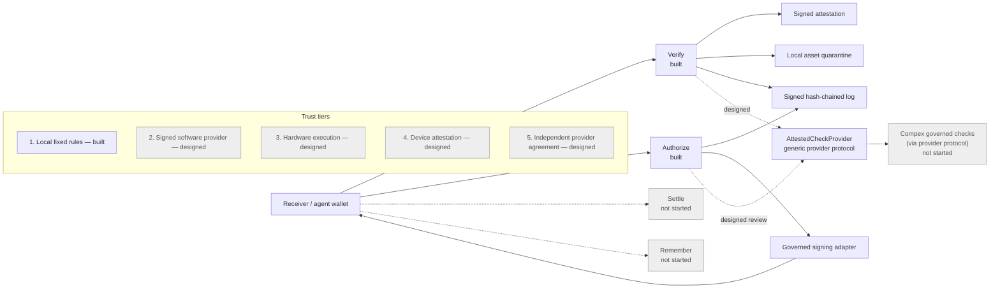
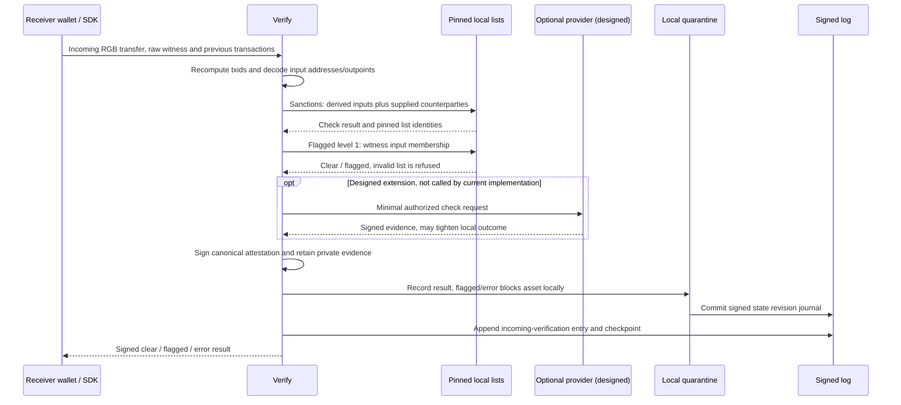
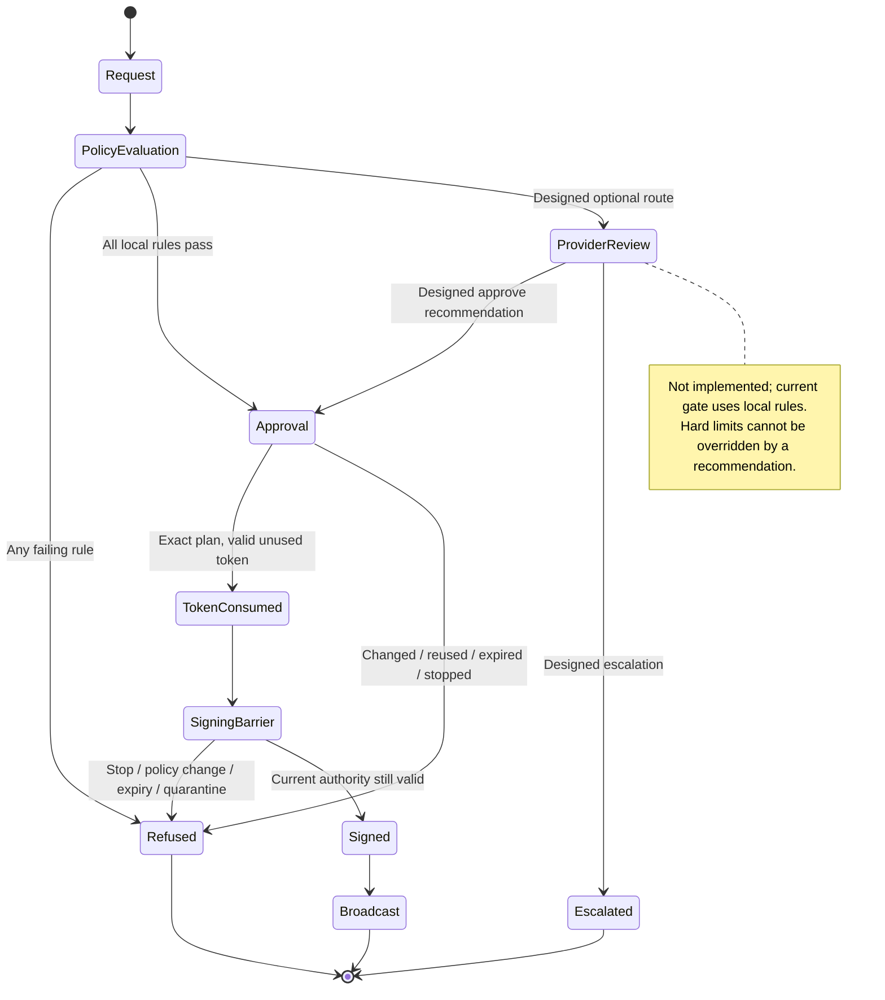

# Trust layer

**The trust layer for dollars on RGB: Verify, Authorize, Settle, Remember.**

Private project by Amir Mohammad Farhang. All rights reserved except reused
material identified in [NOTICE](NOTICE). Built on Utexo's RGB SDK. PassBook is a
separate lending application; this project never lends or holds funds.

## 2. Status and evidence

The accepted baseline passes **88 standard tests, 15 independent security
probes and nine CLI checks**. Independent QA also passes the required live
Verify/Authorize demonstration; see [verification](release/verification.json)
and [QA scope](docs/QA.md). New addendum work below is not covered by that pass.

| Building block or application | Status | Evidence and boundary |
| --- | --- | --- |
| Verify: sanctions, signed local flagged list, witness-input screening | **Built** | Local tests and independently checked actual testnet transfers. |
| Canonical signed attestations and hash-chained log | **Built** | Trusted checker/issuer keys, signed checkpoints and journal-bound mutable state. |
| Receiver asset quarantine | **Built** | Persisted refusal for flagged/error receives; cannot reverse settlement. |
| Authorize: signed limits, one-use transaction-bound approvals, stop, reasons | **Built** | Local/security tests and actual allowed send plus limit/stop refusals. |
| CLI and authenticated localhost API | **Built** | Same Verify/Authorize libraries; local API tests. |
| Utexo flagged-list API | **Stub** | Refuses until its real interface and issuer trust are specified. |
| RGB consignment ancestry screening | **Designed** | No reliable ancestry interface demonstrated with the pinned SDK. |
| Settle: generic escrow | **Not started** | No trust-layer escrow implementation or testnet claim. |
| Remember: portable history | **Not started** | No portable-history implementation. |
| Generic attested provider interface, remote client and DSSE verifier | **Designed** | No provider result has yet been folded into this baseline's attestations. |
| Transfer flow-risk application | **Not started** | No live provider-backed flow-risk claim. |
| Audit evidence pack and verifier | **Not started** | Existing logs/receipts are not the proposed packaged export. |
| Agent-action second-line review | **Not started** | Current hard limits refuse; no provider recommendation or human review workflow. |
| Travel Rule payload check | **Designed** | Documented direction only. |
| Explicit execution labels and QuoteVerifier | **Designed** | Baseline attestations omit `execution`; no hardware quote acceptance is claimed. |

## 3. Why it exists

A receiver must decide whether incoming RGB coins meet its own rules; it cannot
rely on an issuer freeze to undo a received transfer. An agent also needs limits
on what it may spend. Those decisions belong beside the wallet, without giving
this service custody of anyone's money.

Local fixed rules check sanctions, flagged inputs and spending authority.
Optional outside judgment checks are planned to add stricter review, while the
local rules remain authoritative.

## 4. Architecture

Solid paths are built. Dashed paths are designed extensions. Grey components
are not started. Detailed receiver history stays local; portable attestations
carry results, asset/witness identifiers and list versions/hashes.



The provider boundary is a design here, not an active external connection.
Operational URLs and trusted provider keys belong in private configuration,
never in this repository or its dependency graph.

## 5. Verify flow

The wallet SDK validates receipt and asset membership. Verify then independently
decodes the Bitcoin witness and previous outputs, checks local lists, signs its
result and retains receiver evidence.



Missing witness evidence produces an error. Invalid list trust or hashes refuse
verification. Quarantine journal commits precede the final incoming log entry;
the result is returned after this recording, not before it.

## 6. Authorize flow

A signed policy is evaluated against the actual prepared transaction. A durable
one-use approval must be consumed before the adapter signs, and current
policy/stop/quarantine authority is rechecked at the actual signing barrier.



The optional review and escalation states are designed. A signature already
exported cannot be revoked by a later stop. Failed signing attempts keep their
token consumed and their spending reservation conservative.

## 7. Algorithms

These descriptions match the accepted local implementation. Provider folding is
explicitly a design; it does not describe a completed provider integration.

### Flagged coins, level 1 — built

Check the outputs spent by this witness transaction against a trusted list.
This checks Bitcoin witness inputs, not the full RGB consignment history.

```text
manifest = read local manifest
require trusted issuer signature, expected network and current validity
bytes = read confined local list path
require SHA256(bytes) == manifest.sha256
require list identity/version/network/testOnly match manifest
require unique, well-formed outpoints
inputs = decode and validate witness and all required previous transactions
hits = [input.outpoint for input in inputs if input.outpoint in list]
return flagged if hits is nonempty else clear; record list id/version/hash
```

### Sanctions screening — built; public hop-1 discovery not built

Derive input addresses from actual spent outputs rather than caller claims.
Also screen receiver-supplied counterparties; they are not a verified hop-1 graph.

```text
require trusted sanctions manifest hash and each snapshot file hash
addresses = derive supported addresses from decoded input previous outputs
if claimed sender addresses exist: require every claim occurs in addresses
require supplied counterparty addresses are nonempty strings
screened = unique(normalize(addresses + suppliedCounterpartyAddresses))
hits = screened intersect pinnedSanctionsAddresses
return flagged if hits else clear; record snapshot ids/versions/hashes
```

The built scope is input addresses, sometimes called hop 0, plus the supplied
counterparties. Automatically fetching and proving their direct public-chain
counterparties, or hop 1, is designed work. OFAC/OpenSanctions snapshots retain
their source dates; a separate labelled test list supplies testnet hits.

### Canonical attestation and signature — built

Sign the digest of every field except `sig`; independently trust the checker.
A valid signature authenticates that checker's recorded claim and scope.

$$
d = \operatorname{SHA256}(\operatorname{canon}(a \setminus \{\mathrm{sig}\})),
\qquad \sigma = \operatorname{SchnorrSign}_{sk}(d).
$$

```text
canon = recursively sort object keys; retain array order; emit compact JSON
require safe integer numbers; refuse undefined and unsupported values
body = attestation without sig
digest = SHA256(UTF8(canon(body)))
sig = BIP340_Schnorr_sign(digest, checkerSecret)
verify: recompute digest, verify signature with pinned checker public key
also verify issuer/manifest, network, validity and check/result consistency
```

### Hash-chained log — built

Each canonical entry body contains the previous entry's hash. Signed checkpoints
also detect suffix removal relative to the retained checkpoint.

$$
b_i = e_i \setminus \{\mathrm{hash},\mathrm{sig}\},
\qquad h_i = \operatorname{SHA256}(\operatorname{canon}(b_i)).
$$

Here `b_i.prevHash = h_(i-1)` and the first entry has `prevHash = null` and
`seq = 0`. The implementation hashes that JSON body; it does not separately
concatenate a previous hash with another serialized event.

```text
body = {v, domain, seq, prevHash, at, kind, actionId, result, detail, nodePk}
entry.hash = SHA256(canon(body))
entry.sig = sign canonical hash of entry excluding sig (including entry.hash)
append entry; fsync; atomically write signed {count, head, nodePk} checkpoint
verify every sequence, prevHash, content hash, node key and signature
verify checkpoint count/head/signature; return all indexed problems
```

The first indexed error locates a break; verification can report multiple
problems. State revisions/hashes are journaled here too, so restoring an older
snapshot alone is refused. Simultaneous rollback of snapshot, log and checkpoint
needs an independent external anchor; none is built.

### Policy evaluation — built, UTC calendar-day reservations

Evaluate all applicable rules and return the collected `why` reasons.
The cumulative cap uses a UTC calendar day; it is not a rolling time window.

```text
why = []
check policy presence and validity, stop, request signer/agent/time/replay
add every failing check's reason to why
try:
  decoded = decode and bind invoice, recipient map, unsigned PSBT and fee
  add quarantine, wallet/network, adapter-preview and asset failures
  add recipient-allowlist, per-send-cap and Bitcoin-fee-cap failures
  day = UTC_DATE(now)
  if reserved[day] + decoded.amount > policy.maxPerDay:
    why += DAILY_LIMIT_EXCEEDED
catch decode error:
  why += PREVIEW_INVALID with reason
if why is empty:
  reserve amount durably for day; remember request id; issue one-use token
  why = [WITHIN_SIGNED_POLICY_LIMITS]
log decision with why, request/plan/policy hashes; return decision
```

Reservations count even if the send later fails, until the UTC day changes.
Hard-limit refusal has no built human-override path. Typical reasons include
`PER_SEND_LIMIT_EXCEEDED`, `DAILY_LIMIT_EXCEEDED`, `RECIPIENT_NOT_ALLOWED`,
`BITCOIN_FEE_LIMIT_EXCEEDED` and `KILL_SWITCH_STOPPED`.

### One-use approval — built

Bind permission to the decoded transaction, native PSBT, invoice and recipient
map. A changed transaction, expired approval or used token cannot be signed again.

```text
token = sign {random id, actionId, agent/gate/network/wallet,
              planHash, policyHash, policyVersion, issuedAt, expiresAt}
expiresAt = min(now + policyTTL, policy expiry, request expiry)
consume: verify signatures, exact plan/preview, current policy/time/stop,
         quarantine and stored unused token; durably mark token used
at actual signing barrier: recheck current authority and exact consumed token
adapter permits one signing attempt; only then may it export a signature
```

### Receiver quarantine — built

Flagged or error receives block the asset in that receiver wallet's governed
path. A later clear result does not automatically erase an earlier block.

```text
append receive record under (network, walletId, assetId) in signed journaled state
before governed spending: load verified current state
if any retained record is flagged or error: refuse asset send with reasons
```

This is local spending enforcement. It cannot reverse a confirmed transfer or
freeze coins held by a different wallet.

### Provider result folding — designed, not wired into the baseline

An outside provider may tighten the receiver's outcome and never clear a local
flag. Unavailable or untrusted evidence must not silently produce a clear result.

```text
local = run mandatory local rules
provider = verify configured provider's signed evidence and request binding
require allowed software/hardware execution evidence for the selected trust tier
final = stricter(local, mapProviderResultToPolicyOutcome(provider))
retain full envelope locally; sign provider_id/evidence_sha256/result/execution
```

The mapping from `low/review/high` or `approve/escalate` to a local action needs
an explicit policy. Its wire protocol, DSSE trust pins and live evidence remain
addendum work; no provider output is present in the accepted testnet receipt.

## 8. Attestation format

The current portable document records what was checked and by whom. Raw witness
transactions, previous transactions, addresses and detailed matches remain in
receiver-local evidence rather than the portable attestation.

| Field | Current meaning |
| --- | --- |
| `v`, `domain` | Version 1 and the incoming-attestation signature domain. |
| `network`, `assetId`, `witnessTxid` | Exact network, RGB asset and Bitcoin witness identity. |
| `checks.sanctions` | Result, scope and code for pinned sanctions screening. |
| `checks.flaggedL1` | Result, scope and code for witness-input membership. |
| `checks.rgbAncestry` | Explicit `designed` status and missing-interface code. |
| `lists` | List ids, versions, SHA-256 hashes and test-only labels. |
| `flaggedManifest` | Signed list issuer, identity/hash, network and validity window. |
| `overall` | `error` if a required check errors, otherwise `flagged` on a hit, else `clear`. |
| `time`, `checkerPk`, `sig` | Unix time, checker public identity and BIP-340 signature. |
| `provider_id`, `evidence_sha256`, `provider_result` | **Designed extension; absent from baseline.** Full provider envelope would stay local. |
| `execution` | **Designed extension; absent from legacy signed records.** Current execution is software, without hardware evidence. |

Redacted structural example of the existing format; these placeholders are not
a valid signed result. The actual signed documents are in the testnet receipt.

```json
{
  "v": 1,
  "domain": "trust-incoming-attestation-v1",
  "network": "utexo-testnet",
  "assetId": "REDACTED_ASSET_ID",
  "witnessTxid": "REDACTED_WITNESS_TXID",
  "checks": {
    "sanctions": {"status": "clear", "scope": "decoded witness sending addresses and receiver-local counterparties", "code": "NOT_ON_PINNED_LISTS"},
    "flaggedL1": {"status": "clear", "scope": "decoded witness transaction input outpoints", "code": "NO_FLAGGED_WITNESS_INPUT"},
    "rgbAncestry": {"status": "designed", "scope": "RGB consignment ancestry", "code": "SDK_RELIABLE_ANCESTRY_API_REQUIRED"}
  },
  "lists": [
    {"id": "REDACTED_SANCTIONS_LIST", "version": "REDACTED", "sha256": "REDACTED", "testOnly": false},
    {"id": "test-demo-flagged-outpoints", "version": "1", "sha256": "REDACTED", "testOnly": true}
  ],
  "flaggedManifest": {
    "v": 1, "domain": "trust-flagged-manifest-v1", "file": "flagged-outpoints.json",
    "sha256": "REDACTED", "listId": "test-demo-flagged-outpoints", "version": "1",
    "network": "utexo-testnet", "testOnly": true,
    "issuedAt": 1792482390, "expiresAt": 1792568791,
    "issuerPk": "REDACTED_PUBLIC_KEY", "sig": "REDACTED_SIGNATURE"
  },
  "overall": "clear",
  "time": 1792482392,
  "checkerPk": "REDACTED_PUBLIC_KEY",
  "sig": "REDACTED_SIGNATURE"
}
```

Adding `execution` or provider fields changes the signed body. Existing records
must remain byte-for-byte intact; their original signatures must not be amended
to manufacture newer evidence.

## 9. Compliance applications through outside providers

Available provider: [Compex](https://getcompex.com). These applications are
proposed provider capabilities, not completed integrations in this baseline.
Local fixed rules remain local and always take precedence over a recommendation.

| Priority | Application | Intended input and output | Current status |
| --- | --- | --- | --- |
| P0 | Transfer flow-risk screening | Receiver-authorized transfer context and public chain data; evidence-bound pass-through, fan-in, circular-flow and prefunding findings; `low/review/high` plus codes/evidence ids. | **Not started**; no live evidence hash in an attestation yet. |
| P1 | Audit evidence pack | One decision's attestation, log entries, provider run record and policy; ZIP, hash manifest and verifier. | **Not started**. Intended record-keeping support is not legal compliance certification. |
| P1 | Agent-action review | Soft-threshold request context; signed `approve/escalate` recommendation. Hard-threshold review requires a human design, never an AI override. | **Not started**. |
| P2 | Travel Rule payload check | Originator and beneficiary payload validation between service providers. | **Designed**, documentation only. |

The planned rule is “AI investigates, code decides”: findings must refer to
allowed evidence, and deterministic code confirms them. Outside providers
keep their runtime code, packages, operational endpoints and signing keys out
of this repository. Provider-specific implementation lives separately.

## 10. Trust tiers and hardware readiness

| Tier | Trust model | Current status |
| --- | --- | --- |
| 1 | Local fixed rules, pinned lists and receiver-owned signing. | **Built**, with the boundaries below. |
| 2 | Named outside AI provider with signed software evidence; a trusted host remains in the trust boundary. | **Designed** here; no provider-backed live receipt yet. |
| 3 | Hardware-attested execution; AWS Nitro first, with vendor-root and approved-measurement verification. | **Designed**; no real hardware quote verified. |
| 4 | Device-attested checks on the receiver's phone. | **Designed**. |
| 5 | Two or more independent providers must agree under an explicit policy. | **Designed**; no quorum implementation. |

Everything currently demonstrated executes in **software**. Signed software
evidence authenticates a signer's statement; it does not prove hardware
isolation. Explicit `execution` serialization and the `QuoteVerifier` interface
are not yet built in this baseline.

The designed labels are `software`, `tee:aws-nitro`, `tee:intel-tdx`,
`tee:amd-sev-snp`, `device:apple-app-attest` and
`device:android-key-attestation`. A `tee:*` label may be accepted only after a
hardware attestation verifies against a trusted vendor root, binds the request
and freshness, and matches an approved release measurement. A test vendor
would exercise valid, wrong-root, wrong-measurement and replay cases; such a test
would establish interface behavior, not real hardware execution. These tests
are not yet part of the accepted 88-test baseline.

## 11. Limits and threat model

- A holder of raw wallet keys or direct SDK access can bypass the governed path.
- RGB receive/asset membership relies on the receiver-owned SDK/indexer. Full
  consignment ancestry screening is designed, not built.
- Sanctions scope is decoded input addresses plus receiver-supplied
  counterparties; automatic public hop-1 graph discovery is not built.
- The Utexo list API is a stub. Local demo lists are test-only, not a production
  flagged-coin service. “Clear” is limited to the recorded checks and versions.
- Quarantine cannot reverse transfers and has no automatic release on a later
  clear result. A stop cannot revoke an already exported signature.
- Restoring state alone is refused against the retained signed journal.
  Rolling back every snapshot, log and checkpoint together needs an external
  anchor; none is built. Ambiguous crash/legacy state fails closed; automatic
  offline recovery is not implemented.
- Daily spending reservations remain counted after failed sends until UTC day
  rollover. There is no rolling-window spending cap.
- Settle and Remember are not started. Provider checks, audit exports and
  hardware execution have no baseline acceptance claim.
- OFAC/OpenSanctions snapshots are pinned. OpenSanctions retains CC BY-NC
  terms; see [NOTICE](NOTICE) and the snapshot manifest for source/licence terms.

## 12. Recorded testnet proof

The required live Verify/Authorize demonstration passed independent QA on
**Bitcoin testnet3**, as documented in Utexo's SDK (`utexo-testnet`). **Mutinynet
fallback was not used.** New A/B wallets used public faucet coins. The issued
asset is **“test USD, not USDT.”**

| Actual transfer | Public witness | Recorded result |
| --- | --- | --- |
| Clear incoming RGB | [e8113fd72c02ea54f87520e2fdcf6cc8176a739e624930fe1f6447a9c6b00e06](https://mempool.space/testnet/tx/e8113fd72c02ea54f87520e2fdcf6cc8176a739e624930fe1f6447a9c6b00e06) | Confirmed block 5,195,546; signed clear. |
| Flagged-input RGB | [8543f746c5a1d0a453a2c549814470ea94fc4e766049ef0b0daf35e724d7996b](https://mempool.space/testnet/tx/8543f746c5a1d0a453a2c549814470ea94fc4e766049ef0b0daf35e724d7996b) | Confirmed block 5,195,834; signed flagged and receiver quarantine. |

Both sends were governed and within signed limits. Subsequent requests were
refused with `PER_SEND_LIMIT_EXCEEDED` and, after stop, `KILL_SWITCH_STOPPED`.
The first receiver attempt produced a signed Taproot-decoding error. A reviewed
fix rechecked the same clear witness; its original error, history and quarantine
remain retained. A later clear result does not erase the earlier block.

Independent QA recomputed public transaction IDs, checked both explorers,
pinned signer/list identities, signed logs and actual quarantine/refusals. See
[receipt](release/testnet-receipt.json), [verification](release/verification.json)
and [read-only five-minute walkthrough](docs/DEMO.md). This proof covers local
Verify/Authorize, not the proposed provider applications, TEE, escrow or history
product. [Architecture](docs/ARCHITECTURE.md) describes the baseline in more detail.

## 13. Run it

Use **Node 22 or 24**. WDK, SDK and native binding versions are pinned in
`package-lock.json`. Run tests and a fresh local synthetic walkthrough:

```sh
npm ci
npm run check
node --import tsx --test qa/*.test.ts
bin/trust demo-local --state-dir .state/local-demo
```

The demo refuses an existing state directory; choose a new name for a repeat.
It prints `liveTransfers: false`, clear/flagged results and within/over/stop
policy outcomes. Its stop is already active and its transactions are synthetic.

Verify its results and log using its generated private configuration:

```sh
source .state/local-demo/secrets.env
bin/trust attestation verify .state/local-demo/attestation-clear.json --config .state/local-demo/trust.config.json
bin/trust log verify --config .state/local-demo/trust.config.json
bin/trust serve --config .state/local-demo/trust.config.json
```

The API binds `127.0.0.1` and requires the generated bearer token. In another
terminal, using the same local-demo environment, check the log:

```sh
source .state/local-demo/secrets.env
curl --fail --silent --show-error http://127.0.0.1:46421/v1/log/verify \
  -H "Authorization: Bearer $TRUST_HTTP_TOKEN" \
  -H 'Content-Type: application/json' \
  --data '{}'
```

Other authenticated POST routes mirror the CLI: `/v1/verify-incoming`,
`/v1/attestations/verify`, `/v1/policy`, `/v1/authorize`, `/v1/stop` and `/v1/why`.
The server refuses browser-origin requests. Keep environment files, keys and
raw receiver evidence private.

For existing portable proof, `bin/trust attestation verify FILE --checker-pk HEX
--issuer-pk HEX` needs only independently trusted public keys; it does not open
a wallet. Follow [DEMO.md](docs/DEMO.md) for the recorded proof and pins.

For a new receiver, adapt the [example configuration](fixtures/trust.config.example.json)
to its identity and independently trusted public keys. Policies, requests,
previews and stop files require their proper signatures. For a separate new
public testnet run, follow [NETWORK.md](docs/NETWORK.md); preserve prior wallets
and evidence. The pinned SDK requires `donation=true`, colorable UTXOs before
the first send, and handling transfer statuses as strings.

Planned provider configuration uses placeholders only; these variables are
**not consumed by the accepted baseline**:

```dotenv
TRUST_PROVIDER_URL=
TRUST_PROVIDER_KEYS_FILE=
```

No provider URL, signing key or private runtime dependency should be committed.
All meeting material is a draft for Amir; Amir alone sends it externally.
