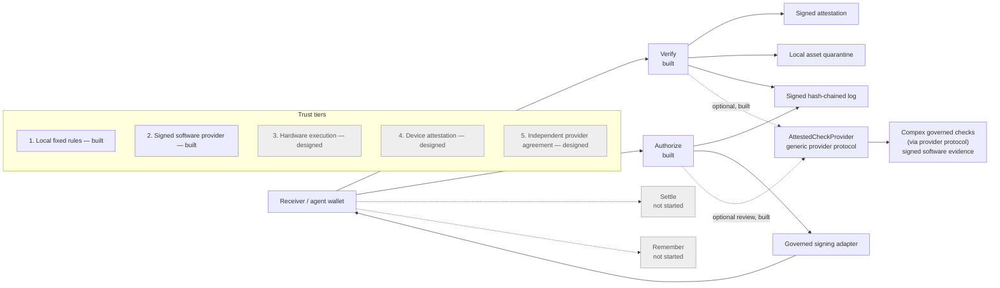

# Trust layer architecture

Private working project. Owner: Amir Mohammad Farhang. The implementation uses
Utexo's RGB SDK; it does not claim a partnership. Lending, credit scoring and
External provider runtime code are outside this project.

## Verify: receiver-owned evidence

The receiver's wallet validates an incoming RGB transfer. The network adapter
obtains its witness transaction and the raw transactions spent by its inputs.
Verify recomputes transaction IDs and derives sending addresses from the spent
output scripts. Caller-supplied address expectations cannot replace that work.

The sanctions provider checks pinned OFAC and OpenSanctions snapshots, plus a
separate, clearly labelled demo list. The local flagged-outpoint provider checks
the decoded witness inputs against a versioned file whose bytes are SHA-256
pinned and whose manifest is signed by a separately trusted issuer. Unknown or
missing evidence produces an error rather than a clear result.

The receiver signs a canonical JSON attestation identifying the network, asset,
witness transaction, check results and list versions/hashes. Raw transactions,
addresses and matching input details remain in the receiver's private state.
The hash-chained log and signed local checkpoint make modification and suffix
truncation detectable relative to the checkpoint. An external verifier must
already trust the checker key and list issuer; a self-supplied key proves no
identity. The log is local evidence, not a public timestamping service.

Mutable gate and quarantine snapshots carry monotonically increasing revisions
and signed hashes committed to that journal. Restoring an older signed snapshot
while retaining the newer log is refused. An interrupted prepare/commit also
fails closed. Rolling back the snapshot, journal and checkpoint together requires
an independent external anchor; that is not built. Legacy state formats are
refused rather than silently migrated. Preserve wallet seeds and evidence when
creating a fresh governance/log directory for the new format.

RGB consignment ancestry screening is **designed**, pending a reliable history
interface. The Utexo flagged-list provider is a **stub** awaiting its real API.
Witness-input screening does not establish a complete asset provenance history.

## Authorize: gate before wallet signing

An owner-signed policy governs the agent key, network, assets, destinations,
per-send limits and cumulative spending limits. The wallet supplies a signed
decoded preview. The gate binds approval to that preview and the native PSBT,
reserves spending durably, and issues a short-lived token usable once.

The signing adapter must consume that token against the actual transaction
before exporting a signature. Changed transactions, replayed tokens, exhausted
limits and the stop switch cause refusal. The stop switch also invalidates
unconsumed approvals. Decisions are logged with reasons readable through `why`.
The gate is effective only for sends routed through the governed wallet adapter;
it is not an operating-system boundary against the wallet-key owner.

## Interfaces, state and network

The CLI and authenticated HTTP API on `127.0.0.1` call the same libraries. Keys
come from environment variables or ignored files; receiver evidence and wallet
state stay in private directories. No seeds, tokens or private keys belong in
Git or in the public receipt.

A single network selection chooses the primary Utexo SDK Bitcoin testnet3 setup
or the explicitly labelled Mutinynet fallback. SDK versions are pinned. Tests
use isolated local fixtures; only recorded, explorer-checked transactions count
as a live network demonstration.

**Settle** and **Remember** are not started in this repository. Neither is part
of the required Verify/Authorize proof until its
tests and transaction receipt establish otherwise. Consult `release/verification.json`
and `release/testnet-receipt.json` for acceptance status, rather than treating this
architecture description as a completed testnet run.

## Component diagram

Solid paths are built. Dashed paths show optional checks or designed extensions. Grey components are not started.

